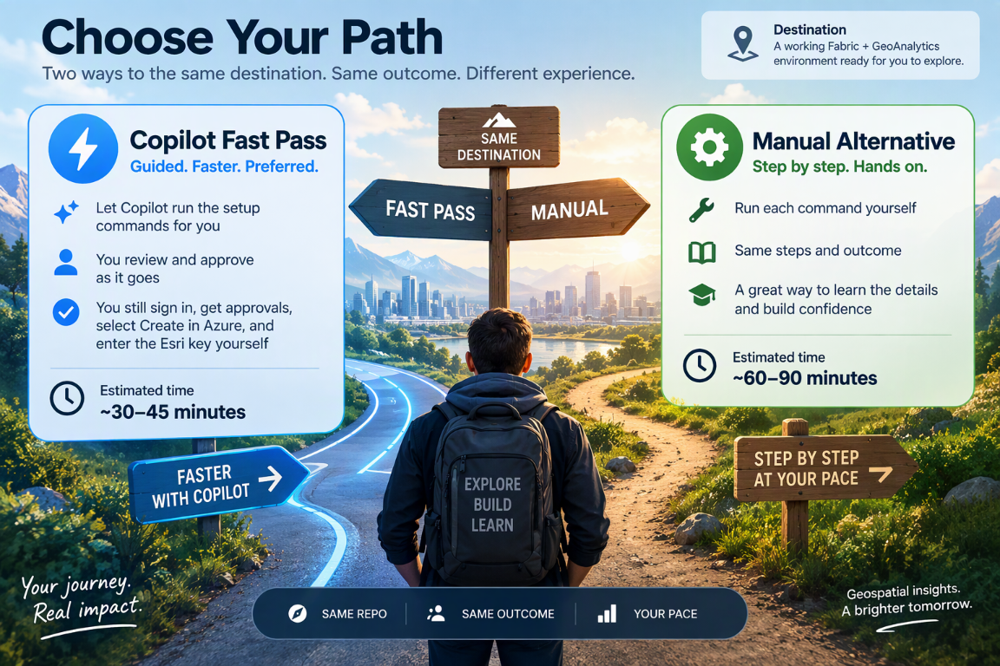

## 01 Start here

Start here, even if you have never deployed to Azure or used Fabric.
You do not need to write Bicep or change the code.

### Where

Start in your browser. The instructions tell you when to install tools,
download a local copy of the repository and open VS Code.
Open the **whole cloned repository** in VS Code, not a numbered subfolder.
Run terminal commands from the main folder containing `deploy.ps1`.

The illustrated time estimates are not guaranteed. Approvals, provisioning and
compute startup can take longer.

### Do

Choose one route and keep following that route through folders 01-04:

* [Copilot Fast Pass, preferred: FP01-FP08](./copilot.md)
* [Manual alternative: Steps 01-12](./manual.md)

With Copilot, you review its requests and let it run the setup commands.
You still sign in, get the required approvals, select **Create** in Azure
and enter the Esri key yourself. If you prefer to run each command yourself,
choose the manual route. You only need one route.

### See

Your tools work and the correct repository is open. The guide helps you
confirm the Azure account, Fabric capacity, GeoAnalytics setting, Esri
license, permissions and costs you need.
If something is missing, it identifies who to contact. You can prepare
your computer while waiting for approvals, but do not deploy or run the
workload until those approvals are in place.

### Next

After FP08 or manual Step 12 confirms that you are ready, open
[02 Deploy Azure](../02-deploy-azure/README.md).

[Back to the story and journey overview](../README.md)
