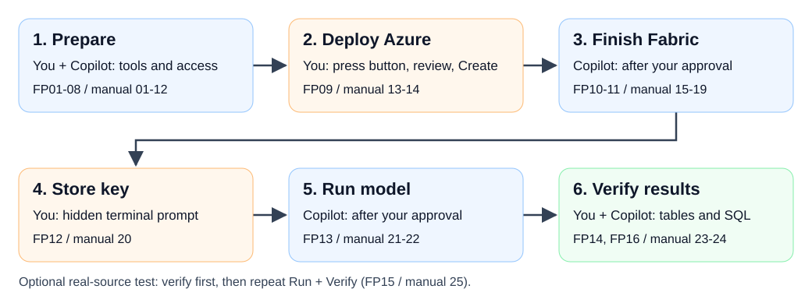

[Stage overview](./README.md) | [Journey home](../README.md#start-here)

Run terminal commands from the main repository folder containing `deploy.ps1`,
not from this numbered subfolder.


## Use Copilot as your deployment guide

This is the recommended route. Read one step, do the named action,
and let **GitHub Copilot in VS Code on your computer** run the repeatable
commands. You do not need to know Azure administration, Fabric REST, or Bicep
syntax. You will need the Azure/Fabric permissions and Esri license listed
below. Copilot helps you check them, but cannot grant access or supply a license.

The [manual walkthrough](./manual.md) is the detailed screen-by-screen
reference and fallback, not a second deployment you need to run.

Both routes set up the same model and small sample-data and Atlanta
real-population runs. You will inspect results in Fabric tables and SQL,
not Sean's original map or optional ArcGIS publication. See
[what the test reproduces](./manual.md#what-this-test-reproduces).

### Who does what

| Copilot does                                                         | You do                                                             |
| -------------------------------------------------------------------- | ------------------------------------------------------------------ |
| Check versions, repo state, account metadata and accessible capacity | Install/approve missing software and complete sign-in/MFA          |
| Prepare a nonsecret portal parameter table                           | Review the table, press the blue button and select Create          |
| Read successful Azure deployment state and prepare configuration     | Confirm the five real prerequisite approvals and review edits      |
| Run validation and the approved Fabric finish command                | Approve creation/update of Fabric items                            |
| Verify metadata and run approved preflight/simulation jobs           | Enter the Esri key in a hidden terminal prompt and approve compute |
| Extract actual run/table names and explain SQL checks                | Inspect Fabric UI and confirm Lakehouse/SQL visibility             |

Keep **Manual permissions** enabled and review each command before approving it.
The skill tells Copilot how to help; it does not prevent it from making a
mistake. Do not select blanket approval or unattended permissions.

### Fast Pass sequence

[](../docs/images/accelerator-journey.svg)

Read 01-03 across the top, then 04-05 across the bottom; click for full size.
Follow FP01-FP08 here, then use the Next links to continue through folders
02-04. Do not perform a second manual deployment. Each step starts with
a checkpoint card: **Where**, **Do**, **See**, and a clickable **Next**.
Do not continue when its success condition has not been met.

## FP01 Check what you need before opening Copilot

| Checkpoint | Instruction                                                                          |
| ---------- | ------------------------------------------------------------------------------------ |
| Where      | Your computer, with your private access/approval notes                               |
| Do         | Review the checklist below and note anything you still need to confirm |
| See        | You know which accounts, approvals and license to check |
| Next       | [FP02](#fp02-install-vs-code-and-the-local-tools) to prepare your computer |

Check that you have, or know whom to ask for, the following:

* A Windows computer permitted to install/run VS Code, PowerShell 7, Git,
  Azure CLI, Bicep and Python
* A GitHub account with approved Copilot access and available usage allowance
* Your work/school Azure/Fabric deployment user, tenant GUID and subscription GUID
* Approved subscription deployment and vault role-assignment permissions
* Registered `Microsoft.KeyVault` and `Microsoft.Fabric` providers
* Permission to create a dedicated Fabric workspace and Fabric items
* An approved active F capacity, its Fabric GUID/region, and assignment rights
* Effective **ArcGIS GeoAnalytics for Fabric Runtime** enablement
* An active **ArcGIS GeoAnalytics for Microsoft Fabric** entitlement and its
  authorized API key available through an approved secret-sharing channel
* Approved computer/Spark networking and costs

Your GitHub Copilot account can differ from your Azure/Fabric account.
The Azure browser, Fabric browser and Azure CLI must all use the **same**
deployment user/tenant. A Copilot plan supplies neither Azure nor Fabric access.

You do not need to collect every ID before installing the tools. Continue
with local preparation below; FP08 helps you find the values and confirm
access. For missing permissions, use the
[administrator request in manual Step 12](./manual.md#step-12-confirm-networking-costs-and-administrator-approvals).
Wait for the required approvals before continuing to Azure deployment.
Do not ask Copilot to assume permissions or treat a successful sign-in as approval.
Use an organization-approved Copilot account and data-handling policy;
even nonsecret tenant/resource configuration can be organization-sensitive.

See/expect: a checklist of what you have and what is still needed. Nothing
has been deployed.

## FP02 Install VS Code and the local tools

| Checkpoint | Instruction                                                              |
| ---------- | ------------------------------------------------------------------------ |
| Where      | Your Windows computer and approved installer pages                       |
| Do         | Install/open VS Code and verify the five local tools                     |
| See        | VS Code opens; version checks succeed, including PowerShell 7            |
| Next       | [FP03](#fp03-clone-and-open-the-correct-repository) after the tools work |

1. Open [Download Visual Studio Code](https://code.visualstudio.com/Download).
2. Select the appropriate **Windows** installer for your computer and follow
   the installation prompts. If your organization deploys VS Code centrally,
   use that approved installation instead.
3. Open **Visual Studio Code** from Start.
4. Install/check the remaining tools using
   [manual Step 01](./manual.md#step-01-install-and-verify-the-tools).
   That step has the installer links and version commands for PowerShell 7,
   Git, Azure CLI, Bicep 0.48.1 and Python 3.12.
5. Close/reopen VS Code after installations so it inherits the updated PATH.

See/expect: VS Code opens and the tools are available. No local Spark or
GeoAnalytics installation is required. Stop if installation is blocked by policy;
ask IT instead of bypassing it.

## FP03 Clone and open the correct repository

| Checkpoint | Instruction                                                           |
| ---------- | --------------------------------------------------------------------- |
| Where      | VS Code Command Palette, then the cloned repository's Explorer        |
| Do         | Clone the URL below and open its root folder                          |
| See        | `deploy.ps1`, `docs` and `.github` in the same open root              |
| Next       | [FP04](#fp04-sign-into-github-copilot) after the correct repo is open |

In VS Code:

1. Press **Ctrl+Shift+P** to open the Command Palette.
2. Type **Git: Clone** and select that command.
3. Paste this URL and press Enter:

```text
https://github.com/Tonyfra91/fabric-geoanalytics-deploy.git
```

4. Choose a writable local parent folder in the folder picker.
5. When VS Code offers to open the cloned repository, select **Open**.
   Otherwise use **File > Open Folder** and select `fabric-geoanalytics-deploy`.
6. Review the repository before trusting it. If the trust notification appears,
   use **Manage > Trust** (or the direct trust option in your version) only
   if permitted by your organization.

See/expect: Explorer shows `README.md`, `deploy.ps1`, `Initialize-Experience.ps1`,
`Get-DemoNotebook.ps1`, `deploy`, `docs`, and `.github`.
Open the **repository root**, not `deploy`, the original zombie-demo repo,
or a folder containing multiple unrelated projects.

This uses current `main`, which contains Fast Pass. The older `v0.1.0` tag
does not contain the skill; its immutable Azure template is still used by the button.
If a clone already exists, open it, inspect its Git status, and update a clean
checkout deliberately. Do not reset/discard another person's changes.
If **Git: Clone** is missing, fix Git installation and restart VS Code.

## FP04 Sign into GitHub Copilot

| Checkpoint | Instruction                                                                |
| ---------- | -------------------------------------------------------------------------- |
| Where      | VS Code Accounts/Copilot controls and the sign-in browser                  |
| Do         | Sign in with your approved GitHub Copilot account, then return to VS Code  |
| See        | Copilot Chat is available under the intended GitHub account                |
| Next       | [FP05](#fp05-open-a-powershell-7-terminal) after Copilot sign-in completes |

1. In VS Code, find the Copilot icon/status control and select **Use AI Features**
   or **Sign in to use Copilot**, depending on your version.
2. Alternatively, open the Command Palette and run **GitHub Copilot: Sign in**,
   or use **Accounts > Sign in with GitHub to use GitHub Copilot**.
3. Follow the browser sign-in prompt using the GitHub account with your
   approved Copilot access. Complete any organization SSO/approval requirements.
4. Return to VS Code and accept the sign-in completion/open-VS-Code prompt
   where displayed.

If Copilot commands/features are absent, use **Extensions** (**Ctrl+Shift+X**),
find **GitHub Copilot Chat** from publisher **GitHub**, and install/enable it
through your approved process, then reload VS Code.
Do not install a similarly named third-party deployment extension.

See/expect: Chat is available and the intended GitHub account is signed in.
If Copilot reports an organization policy restriction or exhausted allowance,
resolve it with your account owner or use the manual route.
Reference: [Official Copilot setup](https://code.visualstudio.com/docs/setup/copilot).

## FP05 Open a PowerShell 7 terminal

| Checkpoint | Instruction                                                                                             |
| ---------- | ------------------------------------------------------------------------------------------------------- |
| Where      | VS Code's integrated terminal, at the repository root                                                   |
| Do         | Select PowerShell 7 and run the location/version/file checks below                                      |
| See        | Major version at least 7, the repo path, and `True` for `deploy.ps1`                                    |
| Next       | [FP06](#fp06-choose-a-local-copilot-agent-session-with-manual-permissions) after all three checks match |

1. In VS Code, select **Terminal > New Terminal**.
2. In the terminal profile dropdown, choose PowerShell 7 where available.
   Do not assume **Windows PowerShell** is version 7.
3. Check:

```powershell
$PSVersionTable.PSVersion
Get-Location
Test-Path .\deploy.ps1
```

See/expect: `Major` at least `7`, the cloned repository folder, and `True`.
If the terminal is PowerShell 5.1, run `pwsh` or select the installed
PowerShell 7 profile, then check again.

Keep this terminal for sign-in and the later secret prompt.
**Do not run `configure-secret` yet.**

## FP06 Choose a local Copilot Agent session with manual permissions

| Checkpoint | Instruction                                                                           |
| ---------- | ------------------------------------------------------------------------------------- |
| Where      | A fresh VS Code Chat session for this repository                                      |
| Do         | Choose local Copilot, Agent mode and Manual permissions                               |
| See        | The session is attached to this repo and tool approvals remain enabled                |
| Next       | [FP07](#fp07-start-fast-pass-without-authorizing-deployment) without blanket approval |

1. Press **Ctrl+Alt+I** to open Chat.
2. Select **+** to start a fresh chat for this repository.
3. Configure the session:

| Control                   | Choose                                                          |
| ------------------------- | --------------------------------------------------------------- |
| Environment, if displayed | **This Computer**, not a cloud coding agent or remote container |
| Session Target / harness  | **Copilot**                                                     |
| Agent / mode              | **Agent**, not Ask or Edit                                      |
| Language model            | **Auto**, or an organization-approved available model           |
| Permissions               | **Manual permissions**                                          |

Older versions may use **Agent** in an Ask/Edit/Agent dropdown and individual
tool approvals instead of the newer permission control. Keep approval prompts
enabled. Do not choose **Autopilot**, bypass, or blanket automatic approval.
Reference: [Official agent-session quickstart](https://code.visualstudio.com/docs/agents/quickstart).

See/expect: a local Agent session attached to this repo. It can request terminal
commands/file edits. That capability is not authorization to provision or run compute.

## FP07 Start Fast Pass without authorizing deployment

| Checkpoint | Instruction                                                                                                 |
| ---------- | ----------------------------------------------------------------------------------------------------------- |
| Where      | VS Code Chat input, not the PowerShell terminal                                                             |
| Do         | Select the skill and send the exact read-only starting message below                                        |
| See        | Copilot identifies the skill and proposes preparation, not deployment                                       |
| Next       | [FP08](#fp08-let-copilot-check-preparation-and-confirm-your-prerequisites) after skill loading is confirmed |

1. In Chat, type `/` and select **fabric-geoanalytics-fast-pass** from the menu.
2. Add the following starting message and send it:

```text
Start Copilot Fast Pass for this repository. I am new to Azure/Fabric
deployment. Follow the skill and 01-start-here/copilot.md.
Begin with read-only checks and local preparation only. Check the tools,
repository state and current sign-in. Ask for missing nonsecret values one
at a time. Do not create/update cloud resources, run Spark, retrieve secrets,
or assume prerequisite confirmations. Stop at each approval checkpoint.
```

See/expect: Copilot identifies the
[`fabric-geoanalytics-fast-pass` skill](../.github/skills/fabric-geoanalytics-fast-pass/SKILL.md),
starts preparation, and reports what it will check.
It must not begin Azure/Fabric creation or a notebook job from this message.

If the command is absent:

1. Open **Ctrl+Shift+P > Chat: Open Customizations > Skills**.
2. Check Workspace skills for `fabric-geoanalytics-fast-pass`.
3. Verify the open root contains
   `.github\skills\fabric-geoanalytics-fast-pass\SKILL.md`.
4. Update VS Code if required/approved, reload the window, and start a fresh chat.
5. If slash invocation is unavailable but file attachment is supported, attach
   that `SKILL.md` and this guide using **Add Context** (or `#file` selection),
   and explicitly ask Copilot to follow the attached skill with the starting
   message above. Confirm it read the file before allowing commands.

Do not substitute `/skills` and assume it launches the workflow;
that menu behaves differently across harnesses.
Select the skill explicitly rather than relying on automatic discovery.
If Copilot selects it for a matching request, that still authorizes only
read-only checks/local preparation, not cloud creation or compute.
Reference: [Agent Skills](https://code.visualstudio.com/docs/agent-customization/agent-skills).
If discovery/attachment remains unavailable, stop and use the manual guide.

## FP08 Let Copilot check preparation and confirm your prerequisites

| Checkpoint | Instruction                                                                                                                     |
| ---------- | ------------------------------------------------------------------------------------------------------------------------------- |
| Where      | VS Code Chat/tool approvals; use the terminal only for your sign-in                                                             |
| Do         | Review checks and supply requested nonsecret values/real confirmations                                                          |
| See        | Preparation is verified or clearly blocked; no cloud writes occurred                                                            |
| Next       | [FP09](../02-deploy-azure/copilot.md#fp09-review-parameters-and-press-the-unchanged-blue-button) only when preparation is ready |

Copilot checks your tools, the downloaded files and the deployment template.
It also runs the repository's local checks. Review each requested command
before approving it.
If a tool is missing, it should stop and give installation instructions, not
silently install software or change organization policy.

If Azure CLI is not signed into the approved account, Copilot gives you
sign-in commands. **You** run them in the visible terminal and complete
browser/Windows sign-in and MFA. Follow
[manual Step 03](./manual.md#step-03-choose-the-user-tenant-and-azure-subscription).
It must not ask for your password, MFA code, device code or access token in chat.

Supply only requested nonsecret values, one at a time:

* Expected tenant/subscription GUIDs and deployment user
* Existing Fabric capacity GUID and region, or an explicitly approved new-capacity plan
* Fresh ownership, dedicated group and available vault names
* The five prerequisite approvals, based on your actual administrator/Esri confirmations

If you do not know an ID, ask Copilot to help you find it using
[manual Step 03 for your account and subscription](./manual.md#step-03-choose-the-user-tenant-and-azure-subscription)
and [manual Step 09 for capacity details](./manual.md#step-09-confirm-capacity-access-assignment-rights-and-region).
Keep these values in a private note. Never send the Esri key.

See/expect: tool/test results, account/capacity checks, and a checkpoint table:

| Status         | Meaning                                                           |
| -------------- | ----------------------------------------------------------------- |
| `VERIFIED`     | A command/API result or your explicit manual evidence supports it |
| `AWAITING YOU` | Sign-in, a missing value, a manual action or approval is needed   |
| `BLOCKED`      | A failure or unavailable prerequisite prevents progress           |
| `NOT RUN`      | The stage has not happened                                        |

The local checks should report 27 HTTP compatibility checks, 46 accelerator
checks and 35 handoff checks, plus documentation/template checks. The separate
managed private endpoint suite reports 35 checks.
These confirm the files are ready;
you still need to confirm your access and check the deployed results later.
If an approval is missing, resolve it using
[manual prerequisite instructions](./manual.md#step-04-confirm-azure-deployment-and-role-assignment-permissions).
