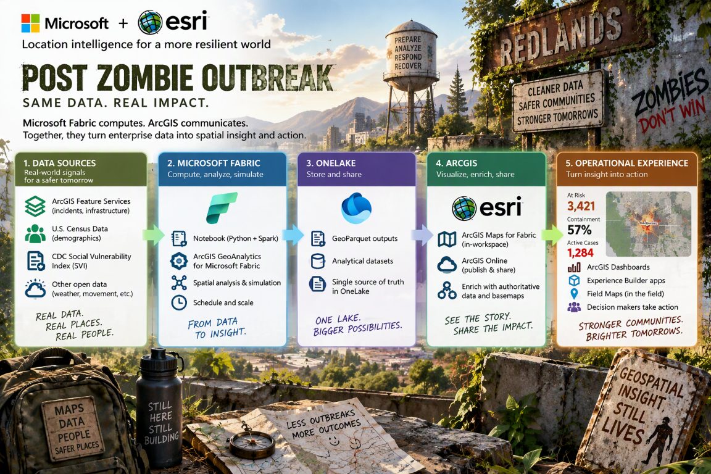
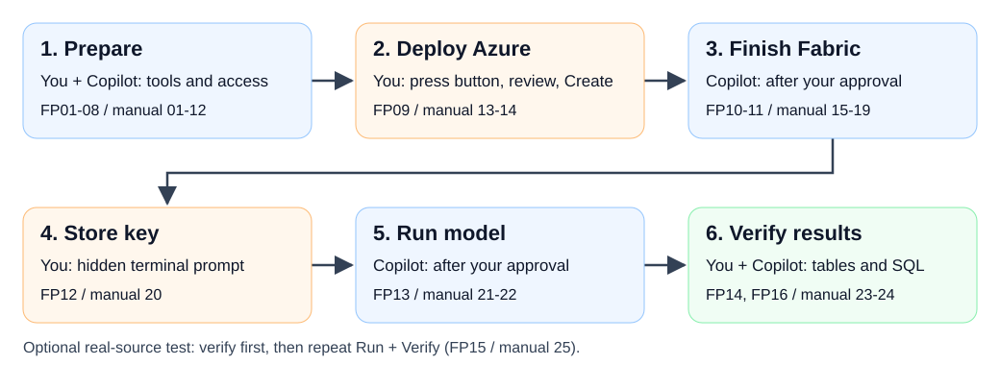

## Post zombie outbreak: same data, real impact

The zombies were the demo. Location intelligence is the opportunity.

The [zombie outbreak demo](https://github.com/SeanKMcG/fabric_zombie_outbreak)
made a spatial pattern memorable: combine location and population data,
analyze relationships, simulate change, and inspect results. The post-zombie
story takes that pattern beyond the fictional scenario, toward questions
about service coverage, infrastructure exposure, and community resilience.

The broader journey is real-world data, spatial computation in Microsoft
Fabric with ArcGIS GeoAnalytics, reusable data in OneLake, and ArcGIS
visualization and operational experiences that help people act.
This repository starts by making the compute and data foundation deployable
and repeatable, rather than copying the original blog.

> [!NOTE]
> The image shows what you could build on this foundation; its maps and
> numbers are examples. This guide sets up Azure and Fabric and produces six
> results tables and a run summary. The pictured GeoParquet exports, ArcGIS
> maps, dashboards and field apps are not included. The fictional model is
> not a public-health forecast. Click the image to see it at full size.

## Start here

**[Open 01 Start here](./01-start-here/README.md)**

Follow folders 01-04 in order. Each explains what to do, what you should
see, and where to go next.
In folder 01, choose Copilot Fast Pass or the manual walkthrough. Both lead
to the same result, so follow just one. Folder 05 offers optional next steps.

Start in your browser. When instructed to clone/open the project in VS Code,
open the **whole repository**, not a numbered subfolder. Run terminal
commands from the main folder containing `deploy.ps1`.
Do not press the Azure button until folder 01's prerequisites are confirmed.

### Use the Azure button when the guide tells you

> [!IMPORTANT]
> The button deploys Azure resources only. It does not create Fabric workspace
> items, configure your Esri key, or run a notebook. Follow the guided finish
> steps after Azure deployment succeeds.

> [!WARNING]
> Azure and Fabric resources can incur charges. Reuse an existing supported F
> capacity when available. Create a new one only with the owner's approval.
> Key Vault uses a public endpoint protected by your work account's
> permissions. Confirm that your organization allows this setup.

## The experience

| Open in order                                      | What you do                                                                    | Continue when                                    |
| -------------------------------------------------- | ------------------------------------------------------------------------------ | ------------------------------------------------ |
| [01 Start here](./01-start-here/README.md)         | Choose a route, install tools, verify identity and prerequisites               | Access and approvals are confirmed               |
| [02 Deploy Azure](./02-deploy-azure/README.md)     | Review parameters, press the button and record outputs                         | Azure deployment succeeds                        |
| [03 Finish Fabric](./03-finish-fabric/README.md)   | Initialize, validate, approve setup, inspect items and enter the key           | Fabric is configured and secret storage succeeds |
| [04 Run and verify](./04-run-and-verify/README.md) | Run the small sample and check its tables, run summary and SQL results | You have checked the results and saved your run ID |
| [05 Next steps](./05-next-steps/README.md)         | Explore optional ideas for using the results | You can stop here or plan a separately approved next step |

### Follow the accelerator in order

Read 01-03 across the top, then 04-05 across the bottom. Click for full size.
The numbers match the folders above. The diagram is an overview, not another
set of deployment instructions.

Start with the small sample-data run. After checking its results, you can
choose whether to try the real-population run.

### Where you work at each stage

| Location                                      | What you do there                                                                       | What you must not assume                       |
| --------------------------------------------- | --------------------------------------------------------------------------------------- | ---------------------------------------------- |
| Local PowerShell 7                            | Install/check tools, sign into Azure CLI, run repo commands                             | Windows PowerShell 5.1 is not sufficient       |
| Azure portal                                  | Check subscription access, press the button, inspect deployment and vault               | Azure success does not create Fabric items     |
| Fabric portal                                 | Verify access before deployment; inspect workspace, jobs, Lakehouse and SQL after setup | Azure access does not imply Fabric permissions |
| Your administrator or Esri subscription owner | Confirm the required settings, permissions and Esri license | Get these approvals before deploying |

## About this guide

This is a preview for small, approved trials, not a production-ready solution.
Check the results in your own workspace using the
[completion checklist](./04-run-and-verify/manual.md#acceptance-checklist).

## Help and reference

* [Troubleshooting](./deploy/README.md#removal-and-troubleshooting)
* [Optional next steps](./05-next-steps/README.md)
* [Where the demo comes from and what is included](./docs/demo-provenance.md)
* [Technical reference and maintenance](./deploy/README.md)
