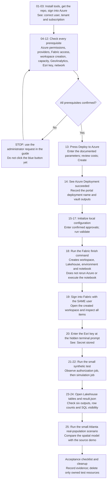

## From spatial demo to deployable experience

Use **Copilot Fast Pass** to guide the deployment, starting with checks and
the big blue button, then finishing a dedicated Microsoft Fabric workspace
with a Lakehouse, a GeoAnalytics-compatible environment, and a parameterized notebook.

The [zombie outbreak demo](https://github.com/SeanKMcG/fabric_zombie_outbreak)
showed a useful spatial pattern: H3 cells, population enrichment, neighborhood
relationships, and time-stepped results. This repository focuses on what it
takes to deploy and verify that pattern, not on reproducing the blog.

[](https://portal.azure.com/#create/Microsoft.Template/uri/https%3A%2F%2Fraw.githubusercontent.com%2FTonyfra91%2Ffabric-geoanalytics-deploy%2Fv0.1.0%2Fdeploy%2Fazuredeploy.json)

**[Start Copilot Fast Pass (preferred)](./docs/copilot-fast-pass.md)**

For a first test, follow the Fast Pass guide from
[FP01](./docs/copilot-fast-pass.md#fp01-check-what-you-need-before-opening-copilot).
It walks you through VS Code setup, skill selection, sign-in, each approval,
the unchanged blue button, and result verification.
Copilot runs the repeatable commands; you control permissions, secrets,
resource creation and compute execution.

Prefer to run the commands yourself?
[Use the complete manual walkthrough](./docs/getting-started.md), starting at
[Step 01: install and verify the tools](./docs/getting-started.md#step-01-install-and-verify-the-tools).
In either route, do not press the button until prerequisites are confirmed.
The manual button reference is
[Step 13](./docs/getting-started.md#step-13-press-the-blue-button-and-enter-the-azure-parameters).
The guide includes the links, manual approvals, fields, commands, expected
screens, success checks, and next action for each step.

> [!IMPORTANT]
> The button deploys Azure resources only. It does not create Fabric workspace
> items, configure your Esri key, or run a notebook. Follow the guided finish
> steps after Azure deployment succeeds.

> [!WARNING]
> Azure and Fabric resources can incur charges. Reuse an existing supported F
> capacity by default. Creating a new capacity requires explicit opt-in.
> Key Vault has public network access in this interactive-user POC.

## The experience

The preferred [Copilot Fast Pass](./docs/copilot-fast-pass.md) executes this
same accelerator in approved stages. Numbers in the diagram below refer to
the manual reference, not to a second deployment you must also perform.

| Stage | What happens | How you verify it |
|---|---|---|
| Prepare | Confirm identity, capacity, tenant enablement, and entitlement | Read-only prerequisite checks |
| Deploy Azure | Create a dedicated resource group, Key Vault, and user RBAC; optionally create capacity | Successful subscription deployment and outputs |
| Finish Fabric | Create workspace, assign capacity, create Lakehouse, publish Runtime 1.3 environment, import notebook | Deployment manifest and status |
| Configure secret | Enter the Esri GeoAnalytics API key through a hidden prompt | Secret metadata, without printing the key |
| Prove the workload | Run authorization preflight and a small synthetic simulation | Six Delta tables, read-back counts, and OneLake receipt |
| Extend | Test real population sources, inspect SQL visibility, and adapt the spatial pattern | Explicit evidence before expanding scope |

### Follow the accelerator in order



If Mermaid is unavailable in your viewer, read this sequence:
tools and identity -> all approvals -> blue button -> Azure success ->
local configuration -> validation -> Fabric finish -> Fabric inspection ->
secret prompt -> two notebook jobs -> tables/receipt/SQL -> real-population run.

### Where you work at each stage

| Location | What you do there | What you must not assume |
|---|---|---|
| Local PowerShell 7 | Install/check tools, sign into Azure CLI, run repo commands | Windows PowerShell 5.1 is not sufficient |
| Azure portal | Check subscription access, press the button, inspect deployment and vault | Azure success does not create Fabric items |
| Fabric portal | Verify access before deployment; inspect workspace, jobs, Lakehouse and SQL after setup | Azure access does not imply Fabric permissions |
| Your administrator or Esri subscription owner | Obtain settings, permission and entitlement approvals | A non-admin cannot grant these to themselves |

## What is in this repository

* [Bicep source](./deploy/main.bicep) and its checked-in
  [portal ARM template](./deploy/azuredeploy.json)
* [Portal configuration initializer](./Initialize-Experience.ps1) that reads
  Azure outputs without provisioning anything
* [Lifecycle entry point](./deploy.ps1) for validation, Fabric completion,
  secret setup, execution, and status
* [Pinned demo retrieval](./Get-DemoNotebook.ps1), with
  [upstream attribution and boundaries](./docs/demo-provenance.md)
* [Detailed operations reference](./deploy/README.md) and
  [architecture and next steps](./docs/architecture.md)
* [Copilot Fast Pass guide](./docs/copilot-fast-pass.md) and a
  [repository deployment skill](./.github/skills/fabric-geoanalytics-fast-pass/SKILL.md)
* Offline regression tests and a template freshness check

The upstream notebook is downloaded locally or supplied by you. It is not
redistributed in this repository. The adapter removes author bindings,
cached results, and ArcGIS publishing from the deployed workload.

## Preferred quick start

1. Follow [Copilot Fast Pass](./docs/copilot-fast-pass.md) to install/open VS Code,
   clone this repo, and sign into GitHub Copilot.
2. Choose a local **Copilot** session, **Agent**, and **Manual permissions**.
3. Select `/fabric-geoanalytics-fast-pass` and send the guide's read-only
   [starting message](./docs/copilot-fast-pass.md#fp07-start-fast-pass-without-authorizing-deployment).
4. Follow its checkpoints. Approve each cloud stage separately and enter
   the Esri key only at the hidden terminal prompt.

This is Copilot-assisted execution, not an unattended deployment or a
permission bypass. Missing prerequisites stop the workflow.

## CLI reminder

The blocks below are a reminder for an already-prepared operator, not the
first-test instructions. For a first test, use the
[complete click-by-click walkthrough](./docs/getting-started.md) and complete
the Azure-button step before running the initializer.

Install PowerShell 7, Git, Azure CLI, and Bicep. Read the
[prerequisites and portal parameter guide](./docs/getting-started.md) before
clicking the button.

```powershell
git clone https://github.com/Tonyfra91/fabric-geoanalytics-deploy.git
Set-Location .\fabric-geoanalytics-deploy
az login --tenant '<tenant-guid>'
az account set --subscription '<subscription-guid>'
.\Get-DemoNotebook.ps1
.\Initialize-Experience.ps1 -AzureDeploymentName '<portal-record-name>' -ExistingCapacityId '<fabric-capacity-guid>'
```

Review the generated nonsecret configuration. Obtain administrator/customer
approval before setting each confirmation to `true`.

```powershell
.\deploy.ps1 validate
.\deploy.ps1 deploy -AzureDeploymentName '<portal-record-name>'
.\deploy.ps1 configure-secret
.\deploy.ps1 run -ParametersPath .\deploy\config\smoke-run.json
.\deploy.ps1 status
```

The portal record name and the template's `deploymentName` are different
identifiers. Initialization maps the template parameters for you.
If Azure created a new capacity, omit `-ExistingCapacityId`.

## Engineering status

This is a preview, not a production-certified accelerator.
Offline tests cover notebook adaptation, parameter validation, failures,
ownership boundaries, the output contract, and the Azure-to-Fabric handoff.
The ARM template is compiled from Bicep; CI checks that it stays synchronized.

A customer deployment is not proven until live environment publication,
runtime Key Vault access, synthetic execution, output read-back, SQL visibility,
and repeat deployment are verified in that customer's tenant.
See the [live acceptance checklist](./docs/getting-started.md#acceptance-checklist).

## Develop and validate

```powershell
.\Get-DemoNotebook.ps1
.\deploy\tests\Test-Accelerator.ps1
.\deploy\tests\Test-Experience.ps1
.\deploy\scripts\Build-Template.ps1 -Check
```

After editing Bicep, regenerate the portal template:

```powershell
.\deploy\scripts\Build-Template.ps1
```

The button pins release `v0.1.0`. Updating `main` does not silently change
that released deployment. A future release must update the button and be
tagged after validation.
