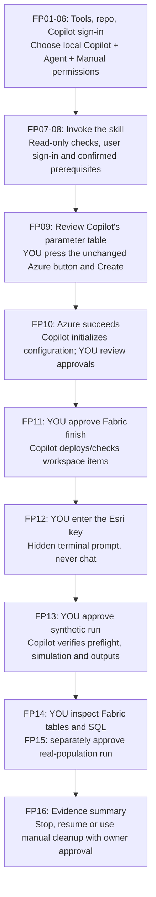

## Use Copilot as your deployment guide

This is the preferred first-test route. You read one step, do the named action,
and let **GitHub Copilot in VS Code on your computer** run the repeatable
commands. You do not need to know Azure administration, Fabric REST, or Bicep
syntax, but you must already have the approved Azure/Fabric access and Esri
prerequisites. Copilot checks them; it cannot create entitlements or grant
itself permissions.

The [manual walkthrough](./getting-started.md) is the detailed screen-by-screen
reference and fallback, not a second deployment you need to run.
The Azure button and Bicep template remain unchanged.

The result is the same deployed model and small synthetic/Atlanta real-population
tests as the manual route. It is not Sean's optional ArcGIS publication,
original map presentation, or a promise of identical large-run outputs.
This repo writes verified Delta/WKT outputs. See
[what the test reproduces](./getting-started.md#what-this-test-reproduces).

### Who does what

| Copilot does | You do |
|---|---|
| Check versions, repo state, account metadata and accessible capacity | Install/approve missing software and complete sign-in/MFA |
| Prepare a nonsecret portal parameter table | Review the table, press the blue button and select Create |
| Read successful Azure deployment state and prepare configuration | Confirm the five real prerequisite approvals and review edits |
| Run validation and the approved Fabric finish command | Approve creation/update of Fabric items |
| Verify metadata and run approved preflight/simulation jobs | Enter the Esri key in a hidden terminal prompt and approve compute |
| Extract actual run/table names and explain SQL checks | Inspect Fabric UI and confirm Lakehouse/SQL visibility |

Keep **Manual permissions** enabled. This skill is guidance to the model,
not a security boundary or a replacement for VS Code tool approval.
Never select blanket approval, bypass, or unattended permissions for this test.

### Fast Pass sequence



If diagrams are unavailable, follow FP01 through FP16 below in order.

## FP01 Check what you need before opening Copilot

Have these ready:

* A Windows computer permitted to install/run VS Code, PowerShell 7, Git,
  Azure CLI, Bicep and Python
* A GitHub account with approved Copilot access and available usage allowance
* Your work/school Azure/Fabric deployment user, tenant GUID and subscription GUID
* Approved subscription deployment and vault role-assignment permissions
* Registered `Microsoft.KeyVault` and `Microsoft.Fabric` providers
* Permission to create a dedicated Fabric workspace and Fabric items
* An approved active F capacity, its Fabric GUID/region, and assignment rights
* Effective **ArcGIS GeoAnalytics for Fabric Runtime** enablement
* An active **ArcGIS GeoAnalytics for Microsoft Fabric** entitlement and its
  authorized API key available through an approved secret-sharing channel
* Approved computer/Spark networking and costs

Your GitHub Copilot account can differ from your Azure/Fabric account.
The Azure browser, Fabric browser and Azure CLI must all use the **same**
deployment user/tenant. A Copilot plan supplies neither Azure nor Fabric access.

If any item is unknown, stop and use
[manual prerequisite Steps 03-12](./getting-started.md#step-03-choose-the-user-tenant-and-azure-subscription)
and their administrator request. Do not tell Copilot “assume all permissions”
or mark an approval true because an API read succeeded.
Use an organization-approved Copilot account and data-handling policy;
even nonsecret tenant/resource configuration can be organization-sensitive.

See/expect: confirmed access, not a new cloud deployment.
Next: FP02.

## FP02 Install VS Code and the local tools

1. Open [Download Visual Studio Code](https://code.visualstudio.com/Download).
2. Select the appropriate **Windows** installer for your computer and follow
   the installation prompts. If your organization deploys VS Code centrally,
   use that approved installation instead.
3. Open **Visual Studio Code** from Start.
4. Install/check the remaining tools using
   [manual Step 01](./getting-started.md#step-01-install-and-verify-the-tools).
   That step has the installer links and version commands for PowerShell 7,
   Git, Azure CLI, Bicep 0.48.1 and Python 3.12.
5. Close/reopen VS Code after installations so it inherits the updated PATH.

See/expect: VS Code opens and the tools are available. No local Spark or
GeoAnalytics installation is required. Stop if installation is blocked by policy;
ask IT instead of bypassing it.
Next: FP03.

## FP03 Clone and open the correct repository

In VS Code:

1. Press **Ctrl+Shift+P** to open the Command Palette.
2. Type **Git: Clone** and select that command.
3. Paste this URL and press Enter:

```text
https://github.com/Tonyfra91/fabric-geoanalytics-deploy.git
```

4. Choose a writable local parent folder in the folder picker.
5. When VS Code offers to open the cloned repository, select **Open**.
   Otherwise use **File > Open Folder** and select `fabric-geoanalytics-deploy`.
6. Review the repository before trusting it. If the trust notification appears,
   use **Manage > Trust** (or the direct trust option in your version) only
   if permitted by your organization.

See/expect: Explorer shows `README.md`, `deploy.ps1`, `Initialize-Experience.ps1`,
`Get-DemoNotebook.ps1`, `deploy`, `docs`, and `.github`.
Open the **repository root**, not `deploy`, the original zombie-demo repo,
or a folder containing multiple unrelated projects.

This uses current `main`, which contains Fast Pass. The older `v0.1.0` tag
does not contain the skill; its immutable Azure template is still used by the button.
If a clone already exists, open it, inspect its Git status, and update a clean
checkout deliberately. Do not reset/discard another person's changes.
If **Git: Clone** is missing, fix Git installation and restart VS Code.

Next: FP04.

## FP04 Sign into GitHub Copilot

1. In VS Code, find the Copilot icon/status control and select **Use AI Features**
   or **Sign in to use Copilot**, depending on your version.
2. Alternatively, open the Command Palette and run **GitHub Copilot: Sign in**,
   or use **Accounts > Sign in with GitHub to use GitHub Copilot**.
3. Follow the browser sign-in prompt using the GitHub account with your
   approved Copilot access. Complete any organization SSO/approval requirements.
4. Return to VS Code and accept the sign-in completion/open-VS-Code prompt
   where displayed.

If Copilot commands/features are absent, use **Extensions** (**Ctrl+Shift+X**),
find **GitHub Copilot Chat** from publisher **GitHub**, and install/enable it
through your approved process, then reload VS Code.
Do not install a similarly named third-party deployment extension.

See/expect: Chat is available and the intended GitHub account is signed in.
If Copilot reports an organization policy restriction or exhausted allowance,
resolve it with your account owner or use the manual route.
Reference: [Official Copilot setup](https://code.visualstudio.com/docs/setup/copilot).

Next: FP05.

## FP05 Open a PowerShell 7 terminal

1. In VS Code, select **Terminal > New Terminal**.
2. In the terminal profile dropdown, choose PowerShell 7 where available.
   Do not assume **Windows PowerShell** is version 7.
3. Check:

```powershell
$PSVersionTable.PSVersion
Get-Location
Test-Path .\deploy.ps1
```

See/expect: `Major` at least `7`, the cloned repository folder, and `True`.
If the terminal is PowerShell 5.1, run `pwsh` or select the installed
PowerShell 7 profile, then check again.

Keep this terminal for sign-in and the later secret prompt.
**Do not run `configure-secret` yet.**
Next: FP06.

## FP06 Choose a local Copilot Agent session with manual permissions

1. Press **Ctrl+Alt+I** to open Chat.
2. Select **+** to start a fresh chat for this repository.
3. Configure the session:

| Control | Choose |
|---|---|
| Environment, if displayed | **This Computer**, not a cloud coding agent or remote container |
| Session Target / harness | **Copilot** |
| Agent / mode | **Agent**, not Ask or Edit |
| Language model | **Auto**, or an organization-approved available model |
| Permissions | **Manual permissions** |

Older versions may use **Agent** in an Ask/Edit/Agent dropdown and individual
tool approvals instead of the newer permission control. Keep approval prompts
enabled. Do not choose **Autopilot**, bypass, or blanket automatic approval.
Reference: [Official agent-session quickstart](https://code.visualstudio.com/docs/agents/quickstart).

See/expect: a local Agent session attached to this repo. It can request terminal
commands/file edits. That capability is not authorization to provision or run compute.
Next: FP07.

## FP07 Start Fast Pass without authorizing deployment

1. In Chat, type `/` and select **fabric-geoanalytics-fast-pass** from the menu.
2. Add the following starting message and send it:

```text
Start Copilot Fast Pass for this repository. I have approved Azure/Fabric access,
but I am new to deployment. Follow the skill and docs/copilot-fast-pass.md.
Begin with read-only checks and local preparation only. Check the tools,
repository state and current sign-in. Ask for missing nonsecret values one
at a time. Do not create/update cloud resources, run Spark, retrieve secrets,
or assume prerequisite confirmations. Stop at each approval checkpoint.
```

See/expect: Copilot identifies the
[`fabric-geoanalytics-fast-pass` skill](../.github/skills/fabric-geoanalytics-fast-pass/SKILL.md),
starts preparation, and reports what it will check.
It must not begin Azure/Fabric creation or a notebook job from this message.

If the command is absent:

1. Open **Ctrl+Shift+P > Chat: Open Customizations > Skills**.
2. Check Workspace skills for `fabric-geoanalytics-fast-pass`.
3. Verify the open root contains
   `.github\skills\fabric-geoanalytics-fast-pass\SKILL.md`.
4. Update VS Code if required/approved, reload the window, and start a fresh chat.
5. If slash invocation is unavailable but file attachment is supported, attach
   that `SKILL.md` and this guide using **Add Context** (or `#file` selection),
   and explicitly ask Copilot to follow the attached skill with the starting
   message above. Confirm it read the file before allowing commands.

Do not substitute `/skills` and assume it launches the workflow;
that menu behaves differently across harnesses.
Select the skill explicitly rather than relying on automatic discovery.
If Copilot selects it for a matching request, that still authorizes only
read-only checks/local preparation, not cloud creation or compute.
Reference: [Agent Skills](https://code.visualstudio.com/docs/agent-customization/agent-skills).
If discovery/attachment remains unavailable, stop and use the manual guide.

Next: FP08.

## FP08 Let Copilot check preparation and confirm your prerequisites

Copilot should check versions, Git status, the pinned demo download, offline
tests and Bicep freshness. Review each requested command before approving it.
If a tool is missing, it should stop and give installation instructions, not
silently install software or change organization policy.

If Azure CLI is not signed into the approved account, Copilot gives you
sign-in commands. **You** run them in the visible terminal and complete
browser/Windows sign-in and MFA. Follow
[manual Step 03](./getting-started.md#step-03-choose-the-user-tenant-and-azure-subscription).
It must not ask for your password, MFA code, device code or access token in chat.

Supply only requested nonsecret values, one at a time:

* Expected tenant/subscription GUIDs and deployment user
* Existing Fabric capacity GUID and region, or an explicitly approved new-capacity plan
* Fresh ownership, dedicated group and available vault names
* The five prerequisite approvals, based on your actual administrator/Esri confirmations

See/expect: tool/test results, account/capacity checks, and a checkpoint table:

| Status | Meaning |
|---|---|
| `VERIFIED` | A command/API result or your explicit manual evidence supports it |
| `AWAITING YOU` | Sign-in, a missing value, a manual action or approval is needed |
| `BLOCKED` | A failure or unavailable prerequisite prevents progress |
| `NOT RUN` | The stage has not happened |

The offline tests should report 39 existing checks and 22 handoff checks,
plus documentation/template checks. They do not establish live tenant acceptance.
If an approval is missing, resolve it using
[manual prerequisite instructions](./getting-started.md#step-04-confirm-azure-deployment-and-role-assignment-permissions).

Next: FP09 only when Copilot reports preparation ready.

## FP09 Review parameters and press the unchanged blue button

Copilot should produce a field-by-field table using your approved values:
subscription, ownership `deploymentName`, region, new group, unique vault,
executing user's `userObjectId`, and the capacity choice.
An existing capacity remains the default. Review it against your private note.

You now open the [repo README](../README.md), press its **Deploy to Azure**
button, enter those fields, and select **Review + create > Create**.
The complete field/screen reference is
[manual Step 13](./getting-started.md#step-13-press-the-blue-button-and-enter-the-azure-parameters).
Copilot must not press Create for you or substitute CLI Azure deployment.

See/expect: Azure **Custom deployment**, then deployment progress.
Wait for **Deployment succeeded**. Record the subscription deployment record
name and inspect Outputs as in
[manual Step 14](./getting-started.md#step-14-record-azure-success-and-the-handoff-outputs).

Tell Copilot:

```text
Azure shows Deployment succeeded. The subscription deployment record name is
<actual-record-name>. Read and verify that deployment; do not redeploy Azure.
```

Replace the placeholder with the actual name; do not use the template ownership
name unless it really is also the record name. Do not send keys/tokens.
If Azure failed, report the redacted error and stop. Do not claim success
because a vault appears in the portal.

Next: FP10.

## FP10 Review the initialized configuration and validation

Copilot verifies Azure state and identity, then proposes
`Initialize-Experience.ps1` using the record name and existing capacity GUID
where appropriate. Approve that command after reviewing its arguments.

See/expect: local `deploy\config\customer.json` is created without overwriting
an existing file. It contains no API key. Copilot should ask before changing
the five confirmation flags and map each to your actual FP08 approvals.
It cannot infer all flags are true from “I have Azure access.”

Review the file in VS Code, including subscription/tenant IDs, capacity,
Azure names, generated Fabric names and each confirmation.
If Copilot presents edits, review/keep only the correct configuration changes.
The manual example is
[Step 16](./getting-started.md#step-16-review-names-and-enter-the-five-genuine-confirmations).
No accelerator source code should be modified to bypass an error.

Copilot then runs `.\deploy.ps1 validate` and reads its exit code/details.
Expect automated `Pass`, approvals `Confirmed`, and exit `0`.
Exit `2` means missing manual confirmations; exit `1` is a failure.
Do not approve Fabric finish until the required checks/approvals are resolved.

Next: FP11.

## FP11 Approve Fabric finish and inspect the deployed items

Copilot should show the exact target and proposed command:

```powershell
.\deploy.ps1 deploy -AzureDeploymentName '<actual-record-name>'
```

Confirm that it includes `-AzureDeploymentName`; bare deploy would provision
Azure again. It must summarize the workspace/items it will create/update and
that no notebook runs yet.
Repeat finish setup republishes the environment and can replace custom edits
to the deployment-owned notebook. Do not approve it merely to inspect a
previously configured workspace; use status instead.

After reviewing the proposal, tell Copilot:

```text
Approve Fabric finish for the displayed subscription, capacity and deployment.
Use the verified Azure handoff. Do not run any notebook yet.
```

Approve the corresponding terminal tool request only if its command matches.
Copilot waits for publication/import, checks exit code, and runs status.
Expect the configured success message, `"stage": "Configured"`,
`"runtimeVersion": "1.3"`, and `"notebookBindingsVerified": true`.

Open [Fabric](https://app.fabric.microsoft.com), sign in as the same deployment
user, select **Workspaces**, then your generated workspace name. Inspect its
Lakehouse, Environment and Notebook using
[manual Step 19](./getting-started.md#step-19-open-fabric-and-inspect-what-was-created).
Do not select **Run all**, manually import the original, or insert a key.
Tell Copilot whether those items are visible. It cannot claim a browser check
it did not perform or receive confirmation for.

Next: FP12.

## FP12 Enter the Esri key yourself outside Copilot tools

Copilot must pause here and give you this command to run in your visible
PowerShell 7 terminal:

```powershell
.\deploy.ps1 configure-secret
```

**You run it. Copilot must not run this interactive secret-entry command
through an agent tool.**

See/expect:

```text
Esri GeoAnalytics API key (hidden):
```

Paste/type the authorized Esri key at that terminal prompt and press Enter.
Never paste it into Copilot chat, an attached file, configuration JSON, a
notebook cell, or a browser form.
Expect:

```text
Secret stored; metadata access verified for the interactive user. Runtime access is checked during run.
```

Tell Copilot only:

```text
configure-secret completed with the Secret stored message. No key is in chat.
Proceed to the synthetic-run approval checkpoint, not to execution yet.
```

If the command failed, provide only the redacted error. Follow
[manual Step 20](./getting-started.md#step-20-enter-the-key-at-the-hidden-powershell-prompt).
Copilot must never request `az keyvault secret show`, raw secret GETs, clipboard
contents, or token output to diagnose this.
If a key was exposed in chat, stop and arrange revocation/rotation with its owner;
do not assume removing text makes the exposure safe.

Next: FP13.

## FP13 Separately approve the synthetic run

Copilot should show `smoke-run.json` settings: two days, 10 km, H3 resolution 6,
synthetic population, seed 42, overwrite disabled. It explains that the command
uses paid Spark capacity and submits preflight plus simulation.

After reviewing that proposal, tell it:

```text
Approve one synthetic run using deploy/config/smoke-run.json for the verified
workspace and capacity. Keep overwrite disabled. Do not submit a real-data run.
```

The proposed command is:

```powershell
.\deploy.ps1 run -ParametersPath .\deploy\config\smoke-run.json
```

Review and approve the matching tool request. Copilot watches that execution,
not a second submission. Expect two jobs when preflight succeeds and exit `0`
with run ID and six verified output names/counts.
For what each message means, use
[manual Steps 21-22](./getting-started.md#step-21-submit-the-first-run-from-powershell).

If preflight fails, no simulation should be submitted. If a command times out,
Copilot must inspect the existing job and stop, not automatically resubmit.
An empty synthetic vulnerability summary is allowed; required origin/grid/
daily-state outputs must be nonempty.

Next: FP14 after verified success.

## FP14 Read the actual results in Fabric and SQL

Copilot runs status and reads the existing nonsecret manifest. It should supply:

* Your workspace URL and generated Lakehouse/notebook names
* The actual run ID, six full table names, and Spark read-back counts
* The exact receipt folder, `Files/zombie_outbreak/run_id=<actual ID>/result.json`
* SQL examples using actual table names, with the schema to verify in the explorer

You open the Lakehouse and SQL analytics endpoint and follow
[manual Steps 23-24](./getting-started.md#step-23-open-the-six-tables-and-onelake-receipt).
That reference covers each click, schema/table expansion, file preview,
**New SQL query**, **Run**, and comparison with receipt counts.

Do not assume SQL synchronization because Spark succeeded. Tell Copilot
whether the previews/counts are visible and match. It must distinguish script-
verified results from your manually verified UI/SQL evidence.
You need no separate SQL database/client or ArcGIS publishing credentials.

Next: FP15 if you want to test the real-source model; otherwise FP16.

## FP15 Separately approve the small Atlanta real-population run

This is the bounded scenario closest to the source demo's real census/SVI
enrichment. It uses Atlanta coordinates, three days, 10 km, H3 resolution 6,
real population, seed 42, and overwrite disabled.
Confirm the public-source network and Esri prerequisites still hold.

After Copilot displays the file/target, tell it:

```text
Approve one real-population run using deploy/config/real-run.json in the same
verified workspace. Keep the bounded settings and overwrite disabled.
Do not increase to the upstream large-run defaults.
```

Review the tool request:

```powershell
.\deploy.ps1 run -ParametersPath .\deploy\config\real-run.json
```

Expect another preflight/simulation pair, a new run ID, and six new outputs.
Repeat FP14 using the new names. An external service/schema failure must be
reported as a failure, not silently replaced with synthetic inputs.
Reference: [manual Step 25](./getting-started.md#step-25-run-the-small-atlanta-real-population-scenario).

You can decline this stage. Copilot then reports real-population validation
as `NOT RUN`, not completed.
Next: FP16.

## FP16 Finish with evidence or resume safely

Ask:

```text
Summarize verified stages, manual confirmations, run IDs, table counts, blockers
and checks not performed. Do not provision, run another job, delete anything,
commit/push local state, or expose credentials.
```

Expect an evidence table, not an unsupported “everything worked” claim.
The [acceptance checklist](./getting-started.md#acceptance-checklist) is the
completion standard. Cloud deployment has not been proven merely because
offline checks and the Copilot skill load correctly.

To stop, select **Stop** in Chat. If a cloud job was already submitted, stopping
Copilot is not a guarantee that job was cancelled. Check its current status.

To resume in a fresh chat, invoke the same skill and say:

```text
Resume Copilot Fast Pass from the existing local configuration and manifest.
Perform read-only state/identity checks first. Do not overwrite configuration,
redeploy Azure, resubmit a possibly running job, or assume approvals from the
previous chat. Ask before the next mutation or compute stage.
```

Use the same deployment user and repo clone. Do not place secret values or
unredacted customer evidence into Git.
If status already verifies a configured deployment, Copilot should skip
another finish operation and ask about the next unverified secret/run stage.
Cleanup is separately owner-approved and manual:
[cleanup instructions](./getting-started.md#cleanup-and-troubleshooting).
The skill deliberately does not automate deletion.
